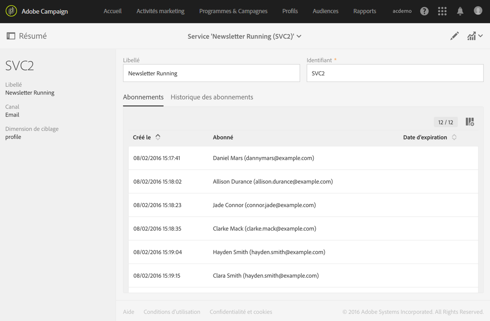
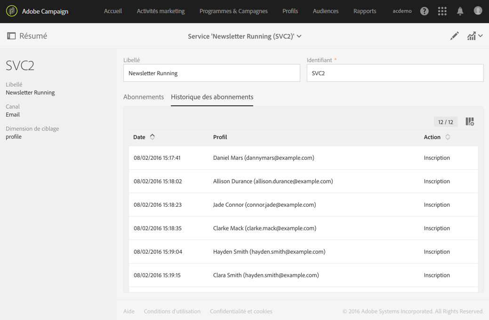
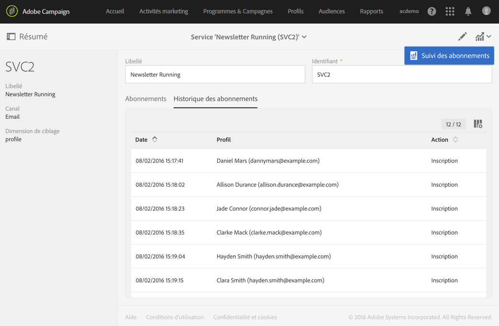
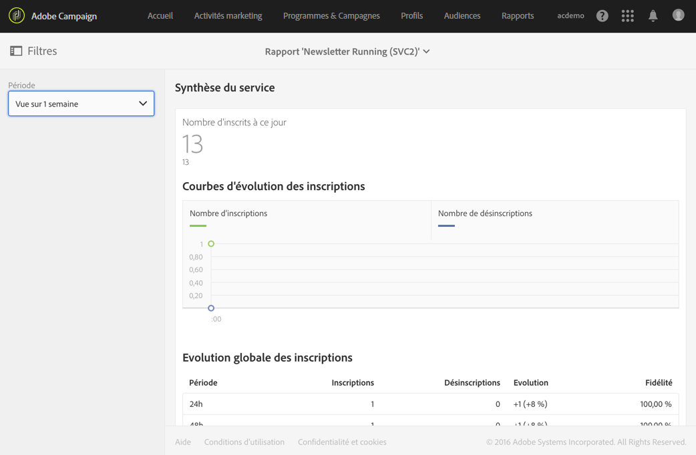
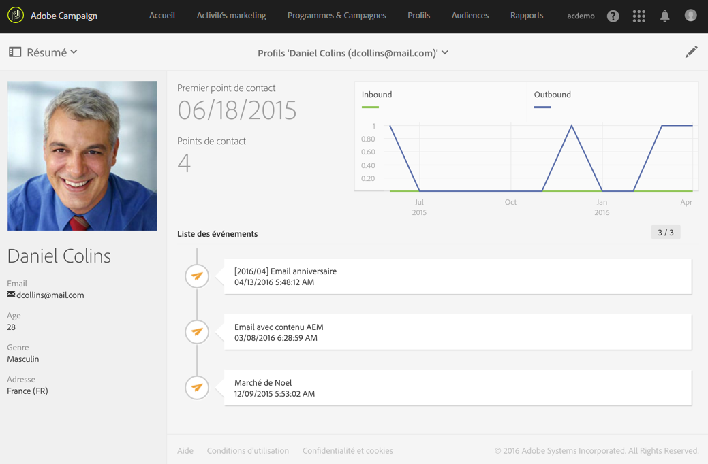

# ler les abonnements{#monitoring-subscriptions}

Utilisez l&#39;interface d&#39;Adobe Campaign pour tracker vos abonnés et mesurer le succès de vos services.

Vous disposez de plusieurs options pour ler les inscriptions et désinscriptions :

* Affichez la liste des personnes actuellement inscrites à votre service dans le tableau de bord du service. Voir [Tableau de bord du service](#service-dashboard).
* Consultez l’historique des abonnements et des désabonnements depuis l’onglet **Historique d’abonnements** du tableau de bord du service. Voir [Historique des abonnements](#subscription-history).
* Affichez un rapport détaillant l’évolution des abonnements et des désabonnements dans les **Rapports** du service. Voir [Rapports du service](#service-reports).
* Recherchez la liste des services auxquels une personne a souscrit depuis son **Profil**. Voir [Historique des événements liés à un profil](#history-of-events-linked-to-a-profile).

## Tableau de bord du service {#service-dashboard}

Pour visualiser la liste des personnes inscrites à un service :

1. Accédez à la liste des services via le menu avancé **Profils &amp; audiences** > **Services**, accessible depuis le logo Adobe Campaign.
1. Sélectionnez le service de votre choix pour afficher le tableau de bord correspondant.
1. La liste des personnes inscrites au service figure sous l&#39;onglet **Abonnements**.

## Applications mobiles {#subscription-history}

Pour consulter l&#39;historique des inscriptions et des désinscriptions au service :

1. Accédez à la liste des services via le menu avancé **Profils &amp; audiences** > **Services**, accessible depuis le logo Adobe Campaign.
1. Sélectionnez le service de votre choix pour afficher le tableau de bord correspondant.
1. Sélectionnez l&#39;onglet **Historique des abonnements** pour afficher les dates auxquelles chaque personne s&#39;est inscrite et désinscrite.

## Rapports du service {#service-reports}

Pour afficher un rapport présentant l&#39;évolution des inscriptions et des désinscriptions :

1. Accédez à la liste des services via le menu avancé **Profils &amp; audiences** > **Services**, accessible depuis le logo Adobe Campaign.
1. Sélectionnez le service de votre choix pour afficher le tableau de bord correspondant.
1. Cliquez sur le bouton **Rapports** dans la barre d&#39;actions, puis sur **des abonnements** dans l&#39;écran de sélection.

   

1. Le rapport **Synthèse du service** présente le nombre d&#39;inscrits, l&#39;évolution globale des inscriptions et une courbe d&#39;évolution dans le temps.

## Historique des événements liés à un profil {#history-of-events-linked-to-a-profile}

Pour connaître la liste des services auxquels un contact s&#39;est abonné, vous pouvez consulter son historique marketing. Pour plus d&#39;informations, consultez la section [Profil client intégré](../../audiences/using/integrated-customer-profile.md).

