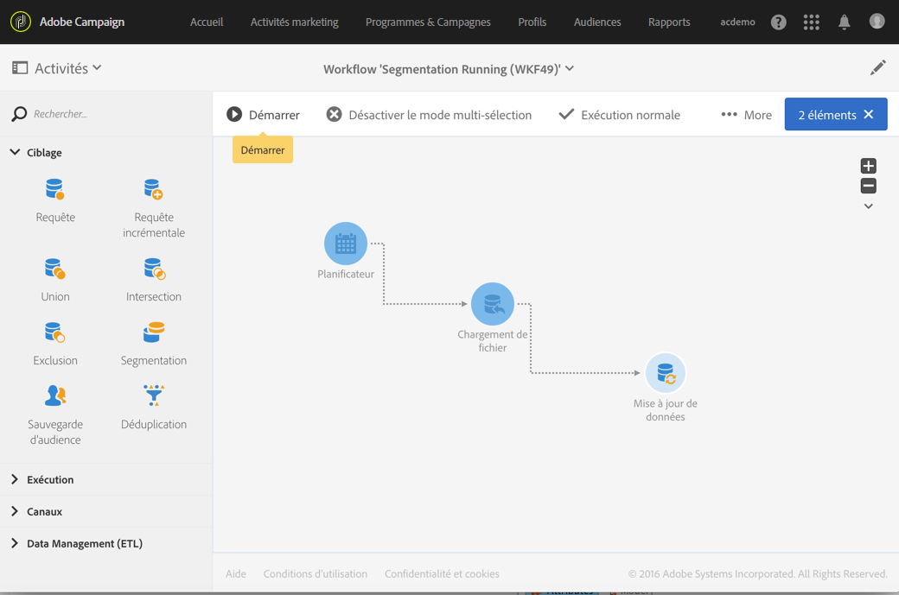

# Commandes d’exécution {#execution-commands}

Les icônes de la barre d’actions permettent de lancer, de tracker et de modifier l’exécution d’un workflow. Voir [La barre d’actions](../../automating/using/workflow-interface.md#action-bar).

Les actions disponibles sont les suivantes :

**Début**

Le bouton  permet de lancer l’exécution d’un workflow, qui prend alors le statut **En cours** (bleu). Si le workflow était en pause, il s’agit d’une reprise, sinon il s’agit d’un démarrage et les activités initiales sont alors activées.

>[!NOTE]
>
>Le démarrage est un processus asynchrone : la demande est enregistrée et sera traitée dès que possible par le moteur d’exécution de workflow.

**Pause**

Le bouton  a pour effet de mettre l’exécution en pause. Le workflow prend le statut **Avertissement** (jaune). Aucune nouvelle activité ne sera activée jusqu’à la prochaine reprise, mais les opérations en cours ne sont pas suspendues.

**Stopper**

Le bouton  arrête un workflow en cours d’exécution, qui prend alors le statut **Terminé** (vert). Les opérations en cours sont interrompues, si possible, et les imports ou requêtes SQL en cours sont immédiatement annulées. Il n’est pas possible de reprendre à l’endroit où le workflow s’est arrêté.

**Redémarrer**

Le bouton  consiste à arrêter, puis redémarrer un workflow. Dans la plupart des cas, cela permet de redémarrer plus vite. C’est également utile pour automatiser le redémarrage lorsque l’arrêt prend un certain temps, car le bouton  n’est disponible que lorsque l’arrêt est effectif.

Lorsqu’une ou plusieurs activités d’un workflow sont sélectionnées, d’autres actions sont possibles :

**Traitement anticipé**

Le bouton  permet de lancer dès que possible la ou les activités sélectionnées en attente.

**Exécution normale**

Le bouton  réactive la ou les activités mises en pause ou désactivées.

**Exécution suspendue**

Le bouton  met le workflow en pause à l&#39;activité sélectionnée : cette tâche ainsi que toutes celles qui lui succèdent (dans la même branche) ne sont pas exécutées.

**Pas d’exécution**

Le bouton  désactive la ou les activités sélectionnées.

>[!NOTE]
>
>Les actions permettant d’agir sur une activité en particulier sont également disponibles depuis les actions rapides, qui s’affichent lors de la sélection d’une activité.
