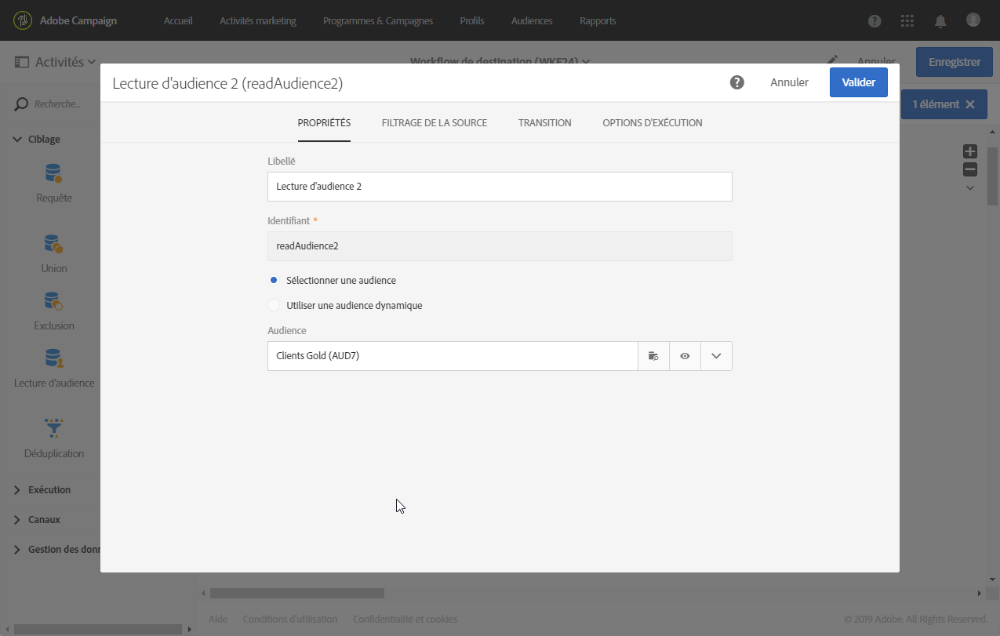

# Lecture d&#39;audience{#read-audience}

## Description {#description}

L&#39;activité **[!UICONTROL Lecture d&#39;audience]** permet de récupérer une audience existante et de l&#39;affiner en y appliquant des conditions de filtrage supplémentaires.

## Contexte d&#39;utilisation {#context-of-use}

L&#39;activité **[!UICONTROL Lecture d&#39;audience]** est une version simplifiée de l&#39;activité **[!UICONTROL Requête]**, conçue pour les cas où l&#39;on souhaite simplement sélectionner une audience existante.

**Rubriques connexes :**

* [Cas pratique : union sur deux audiences affinées](../../automating/using/union-on-two-refined-audiences.md)
* [Cas pratique : réconcilier une audience de type fichier avec la base de données](../../automating/using/reconcile-file-audience-with-database.md)

## Configuration {#configuration}

1. Placez une activité **[!UICONTROL Lecture d&#39;audience]** dans votre workflow.
1. Sélectionnez l’activité puis ouvrez-la à l’aide du bouton , disponible dans les actions rapides qui s’affichent.
1. Sélectionnez l&#39;audience que vous souhaitez récupérer dans l&#39;onglet **[!UICONTROL Propriétés]**.

   Les types d’audience suivants peuvent être récupérés : **[!UICONTROL Liste]**, **[!UICONTROL Requête]**, **[!UICONTROL Fichier]** et **[!UICONTROL Experience Cloud]**. Pour plus d&#39;informations sur les types d&#39;audiences, consultez la documentation [Audiences](../../audiences/using/about-audiences.md).

   L&#39;option **[!UICONTROL Utiliser une audience dynamique]** vous permet de définir le nom de l&#39;audience à cibler en fonction des variables d&#39;événements du workflow. Voir à ce propos [cette page](../../automating/using/customizing-workflow-external-parameters.md).

   

1. Pour appliquer un filtrage supplémentaire à l&#39;audience sélectionnée, ajoutez des conditions via l&#39;onglet **[!UICONTROL Filtrage de la source]** de l&#39;activité.

   Pour plus d&#39;informations sur la création des conditions de filtrage, voir la documentation [Créer des requêtes](../../automating/using/editing-queries.md#creating-queries).

1. Validez le paramétrage de l&#39;activité et enregistrez le workflow.
