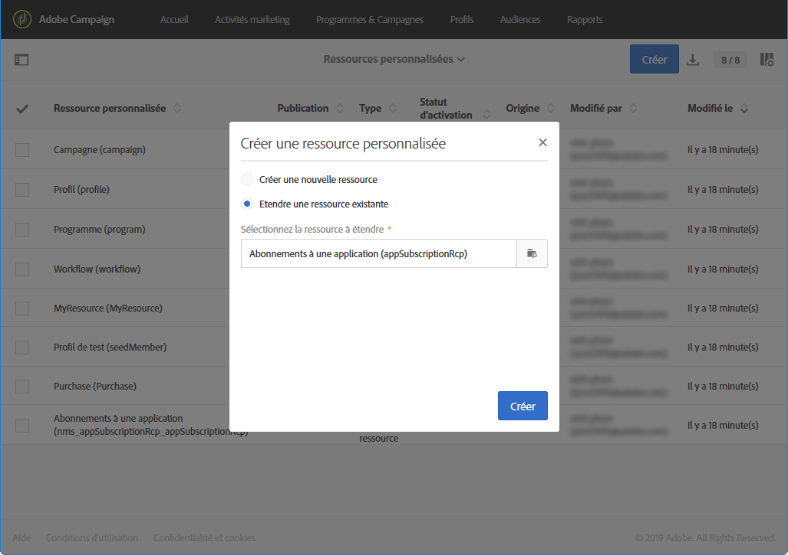
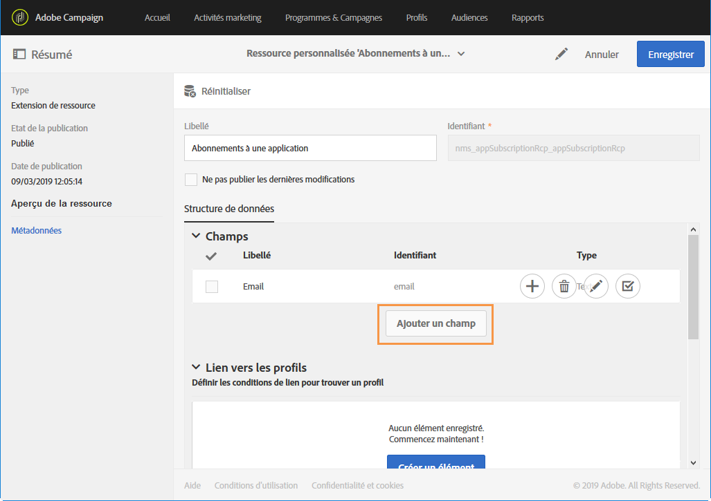
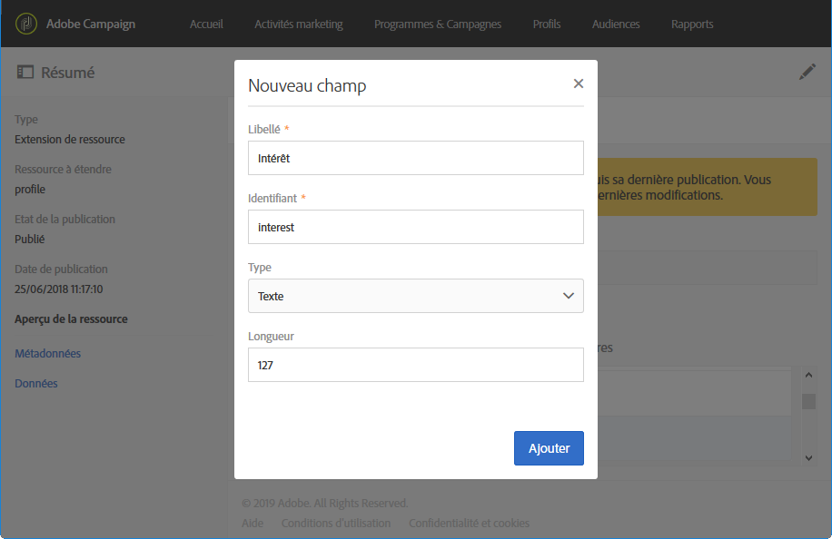
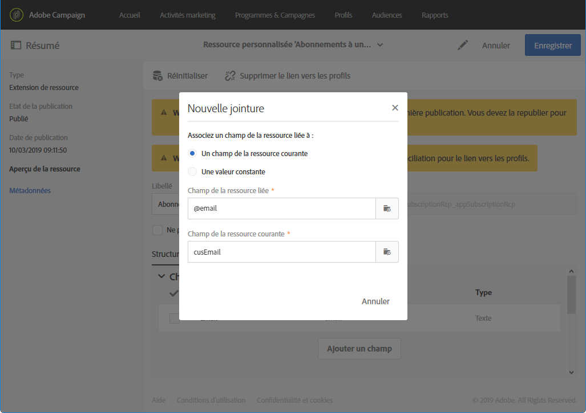

# Extension des abonnements à une ressource d&#39;application{#extending-the-subscriptions-to-an-application-resource}

Dans Adobe Campaign, les données d’attributs de profil mobile envoyées depuis un appareil mobile sont stockées dans la ressource **[!UICONTROL Abonnements à une application (appSubscriptionRcp)]** qui permet de définir les données que vous souhaitez collecter auprès des abonnés de vos applications. Pour plus d’informations sur les ressources personnalisées, consultez [cette page](../../developing/using/key-steps-to-add-a-resource.md).

Cette ressource peut être étendue pour collecter les données que vous avez l&#39;intention d&#39;envoyer depuis d&#39;appareil mobile vers Adobe Campaign.

1. Dans le menu de navigation avancé (via le bouton Adobe Campaign), sélectionnez **[!UICONTROL Administration]** > **[!UICONTROL Développement]**, puis **[!UICONTROL Ressources personnalisées]**.
1. Cliquez sur **[!UICONTROL Créer]** et sélectionnez l&#39;option **[!UICONTROL Etendre une ressource existante]**.
1. Sélectionnez la ressource **[!UICONTROL Abonnements à une application (appSubscriptionRcp)]** et cliquez sur **[!UICONTROL Créer]**.

   

1. Dans la catégorie **[!UICONTROL Champs]** de l&#39;onglet **[!UICONTROL Structure de données]**, définissez les données du client à récupérer de l&#39;application mobile en cliquant sur le bouton **[!UICONTROL Ajouter un champ]**.

   >[!NOTE]
   >
   >Si vous gérez plusieurs applications mobiles, tous les champs utilisés par l&#39;ensemble de vos applications doivent être répertoriés. C&#39;est l&#39;appel de collecte des PII Android ou iOS qui définit les champs capturés par chaque application.

   

1. Ajoutez un **[!UICONTROL Libellé]** et un **[!UICONTROL Identifiant]** pour le nouveau champ. Sélectionnez le **[!UICONTROL Type]** du champ.

   

1. Dans la catégorie **[!UICONTROL Lien vers les profils]**, configurez la clé de réconciliation utilisée pour lier les profils de la base de données Adobe Campaign aux abonnés de vos applications (l&#39;email, par exemple).

   Pour les messages In-App, vous ne pouvez définir qu&#39;une seule clé de réconciliation pour l&#39;ensemble de vos applications mobiles.

   

1. **[!UICONTROL Enregistrez]** et publiez votre ressource personnalisée. Pour plus d&#39;informations sur la publication des ressources personnalisées, consultez cette [page](../../developing/using/updating-the-database-structure.md#publishing-a-custom-resource).
