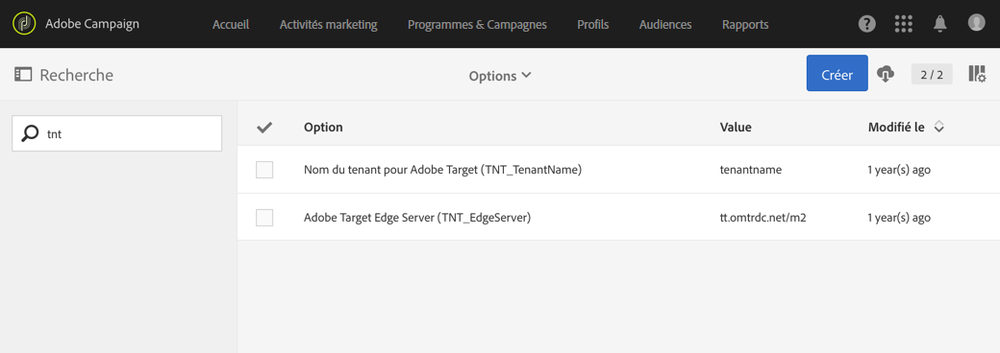

# Configurer l&#39;intégration Campaign-Target{#configuring-the-campaign-target-integration}

L&#39;intégration entre Adobe Campaign et Adobe Target vous permet d&#39;insérer du contenu dynamique dans votre diffusion.

Dans Adobe Campaign, une configuration est d&#39;abord nécessaire pour utiliser les fonctionnalités d&#39;intégration avec Adobe Target. Celle-ci doit être gérée par l&#39;administrateur fonctionnel.

Les éléments suivants sont nécessaires pour cette procédure :

* un Tenant Adobe Experience Cloud
* un tenant Adobe Target
* un &quot;rawbox&quot; Adobe Target défini afin d&#39;établir la connexion avec Adobe Campaign

1. Depuis le menu avancé, via le logo Adobe Campaign en haut à gauche, sélectionnez **[!UICONTROL Administration]** > **[!UICONTROL Paramètres de l’application]** > **[!UICONTROL Options]**.
1. Pour configurer les options de tenant et de serveur pour Adobe Target, renseignez les champs suivants :

   * **[!UICONTROL TNT_TenantName]** : nom du tenant Adobe Target. Cette valeur correspond au nom du **[!UICONTROL Client Adobe Target]**.
   * **[!UICONTROL TNT_EdgeServer]** : serveur Adobe Target utilisé pour l&#39;intégration. Cette option est déjà renseignée par défaut. Cette valeur correspond au **[!UICONTROL Server Domain]** Adobe Target, suivie de la valeur **/m2**. Par exemple : **tt.omtrdc.net/m2**.

   

Vos utilisateurs peuvent désormais ajouter des images dynamiques dans une diffusion avec Adobe Target.
